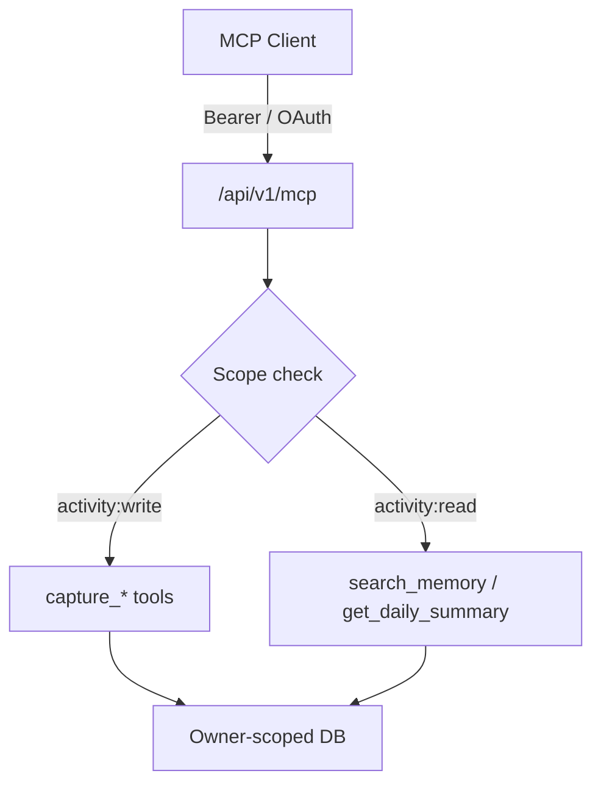

# Re:Mind Me

**Authenticated AI memory and activity capture via MCP.**  
Explicit, owner-scoped recording of activities, decisions, and action items — not silent conversation history import.

<!-- Demo GIF: short recording of token creation + MCP tool call + memory view -->

---

## What problem does this solve?

Agents and AI clients need durable, private memory across sessions without unrestricted access to a user's full conversation history. Re:Mind Me exposes a documented, authenticated MCP interface so clients can deliberately capture structured records and retrieve them later, with clear ownership and token scoping.

## What is implemented

Streamable HTTP MCP endpoint at `/api/v1/mcp` supporting:

| Tool | Purpose | Scope |
|------|---------|-------|
| `capture_activity` | Save activity record | `activity:write` |
| `capture_decision` | Save decision + rationale | `activity:write` |
| `capture_action_item` | Save task (optional due date) | `activity:write` |
| `search_memory` | Search by title/summary/project/category | `activity:read` |
| `get_daily_summary` | Activities + pending actions for a date | `activity:read` |

Authentication:
- OAuth 2.1 + PKCE (preferred)
- Personal bearer tokens (SHA-256 digests only; raw secret shown once)

All reads and writes are scoped to the authenticated owner. Tokens cannot impersonate another user.

## Architecture

- Stateless Streamable HTTP MCP (protocol `2026-07-28` + legacy compatibility).
- Structured request validation and size limits.
- Source label bound to the token (Claude, ChatGPT, Grok, LOG_ON, or manual).
- Deduplication via stable `sourceReference`.
- Existing authenticated REST API remains available for first-party clients.

## What a reviewer can run

See `docs/remote-mcp-activity-memory.md` for full connection instructions.

Minimal verification path:
1. Deploy or run the app.
2. Create a personal bearer token in Settings → AI memory connections.
3. Call the MCP endpoint with a deliberate `capture_activity` or `search_memory`.
4. Confirm the record appears only for the token owner.

Security tests cover authentication, token ownership, privacy scoping, and protocol behavior.

## Evidence that it works

- Documented MCP endpoint, tool schemas, and OAuth/PKCE flow.
- Token digests stored; raw secrets not retrievable.
- Owner-scoped access enforced in tool handlers.
- Explicit limitation documented: this does **not** silently import ChatGPT/Claude/Grok conversation history.

## Honest limitations

- Records only what the client explicitly sends. Background synchronization of provider history is a separate integration.
- OAuth access grants visibility into memory the user has already captured, not automatic provider history ingestion.

## Portfolio value

Strongest evidence of secure AI integrations, MCP, authenticated APIs, and persistent memory.  
Best suited as supporting project for M-KOPA, Kredete, Scale Army, Vennote, and product-oriented roles.

## Further reading

- `docs/remote-mcp-activity-memory.md` — connection guide and security model
- Tool implementation: `src/routes/api/v1/mcp.ts`

## Visual assets to add

1. Demo GIF of Settings → token creation → MCP tool call → memory confirmation.
2. Social preview image (1280×640).
3. Screenshot of the memory UI next to the tools table.
